# aiperf_dgx_station_260918

Raw AIPerf benchmark results for **20 LLMs** served with vLLM on an **NVIDIA DGX Station**
(GB300), run 2026-09-16 to 2026-09-17.

Generated with [aiperf_tool](https://github.com/mwolf-pi3g/aiperf_tool).
Analysis of these results can be found on our blog: https://pi3g.com/blog/

Related result sets:
[aiperf_dgx_station_260919](https://github.com/mwolf-pi3g/aiperf_dgx_station_260919)
(second run of the 5 large MoE models at higher concurrency) and
[aiperf_dgx_spark_260917](https://github.com/mwolf-pi3g/aiperf_dgx_spark_260917) (14 of
these models on a DGX Spark).

---

## Models tested

| Model | Concurrency levels | vLLM image | Model config |
|---|---|---|---|
| google/gemma-4-26B-A4B-it | 1, 4, 16, 32, 64, 128 | v0.29.0 | `core_models.json` |
| google/gemma-4-E4B-it | 1, 4, 16, 32, 64, 128, 256 | v0.29.0 | `core_models.json` |
| google/gemma-4-E4B-it-qat-w4a16-ct | 1, 4, 16, 32, 64, 128, 256 | v0.29.0 | `core_models.json` |
| ibm-granite/granite-4.2-30b | 1, 4, 16, 32, 64, 128 | v0.29.0 | `core_models.json` |
| Inferact/Qwen3.8-27B-NVFP4 | 1, 4, 16, 32, 64, 128, 256 | v0.29.0 | `core_models.json` |
| nvidia/NVIDIA-Nemotron-3-Super-120B-A12B-NVFP4 | 1, 4, 16, 32, 64, 128 | v0.29.0 | `core_models.json` |
| nvidia/NVIDIA-Nemotron-3.5-Lightning-30B-A3B-NVFP4 | 1, 4, 16, 32, 64, 128, 256 | v0.29.0 | `core_models.json` |
| nvidia/Qwen3.6-27B-NVFP4 | 1, 4, 16, 32, 64, 128, 256 | v0.29.0 | `core_models.json` |
| nvidia/Qwen3.6-35B-A3B-NVFP4 | 1, 4, 16, 32, 64, 128, 256 | v0.29.0 | `core_models.json` |
| Qwen/Qwen3.6-27B | 1, 4, 16, 32, 64, 128 | v0.29.0 | `core_models.json` |
| Qwen/Qwen3.6-35B-A3B | 1, 4, 16, 32, 64, 128 | v0.29.0 | `core_models.json` |
| Qwen/Qwen3.8-27B | 1, 4, 16, 32, 64, 128 | v0.29.0 | `core_models.json` |
| Qwen/Qwen3.8-27B-FP8 | 1, 4, 16, 32, 64, 128, 256 | v0.29.0 | `core_models.json` |
| RadixArk/Qwen3.8-Flash-Next-NVFP4 | 1, 4, 16, 32, 64, 128, 256 | nightly | `core_models.json` |
| unsloth/Qwen3.8-27B-NVFP4 | 1, 4, 16, 32, 64, 128, 256 | v0.29.0 | `core_models.json` |
| MiniMaxAI/MiniMax-M2.7 | 1, 4, 16, 32, 64 | v0.29.0 | `big_models.json` |
| nvidia/DeepSeek-V4-Flash-nvfp4-DSpark | 1, 4, 16, 32 | v0.29.0 | `big_models.json` |
| RedHatAI/GLM-5.3-Flash-NVFP4 | 1, 4, 16, 32 | nightly | `big_models.json` |
| zai-org/GLM-5.3-Flash | 1, 4, 16, 32 | nightly | `big_models.json` |
| nvidia/NVIDIA-Nemotron-3-Ultra-550B-A55B-NVFP4 | 1, 4, 16, 32 | v0.22.0 | `nemo_ultra.json` |

---

## Test setup

- AIPerf 0.12.0
- 1024 input / 512 output tokens per request (fixed length, `ignore_eos:true`)
- 300 s per concurrency level, 2 profile runs per level, random seed 42
- Per-model vLLM flags in `conf/model_compose_overrides/`; per-model AIPerf inputs in the
  model config JSONs

---

## Contents

| Path | Content |
|---|---|
| `artifacts/<timestamp>_<model>_c<levels>/` | One folder per model (20) |
| `…/aggregate/concurrency_<N>/profile_export_aiperf_aggregate.{json,csv}` | Aggregated metrics per concurrency level |
| `…/aggregate/sweep_aggregate/` | Metrics across the sweep |
| `…/profile_runs/trial_000N/` | Raw per-run AIPerf exports |
| `…/plots/` | Auto-generated plots and `summary.txt` |
| `conf/base_compose.yaml` | Shared Docker Compose base |
| `conf/model_compose_overrides/` | The 20 per-model vLLM overrides used |
| `conf/core_models.json` | Model config for the first 15 models |
| `conf/big_models.json` | Model config for 4 large MoE models |
| `conf/nemo_ultra.json` | Model config for Nemotron-3-Ultra |
| `logs/` | `container_setup` logs, 2026-09-16 to 2026-09-17 |
| `model_bringup.json` | Container start-to-ready times |
| `app_versions.txt` | Installed packages on the Station (`apt list --installed`) |

---

## Notes

- The exact build of the `nightly` vLLM image was not recorded.
- Artifact folder timestamps use the Station's clock (8 h ahead of the UTC times in
  `model_bringup.json`).
- The model-level plots in `artifacts/<run>/plots/` were regenerated on 2026-10-26 with
  `aiperf plot` 0.12.0. The `aggregate/` files contain no GPU telemetry, so for plotting
  only, a copy of each aggregate file was given the telemetry block recorded in the
  matching `trial_0001` run (1 GPU). The data files in this repo are unchanged.

---

## Quick Takeaways

Pareto curve per model: output token throughput per GPU vs. per-user interactivity (generated by `aiperf plot`).

### google/gemma-4-26B-A4B-it

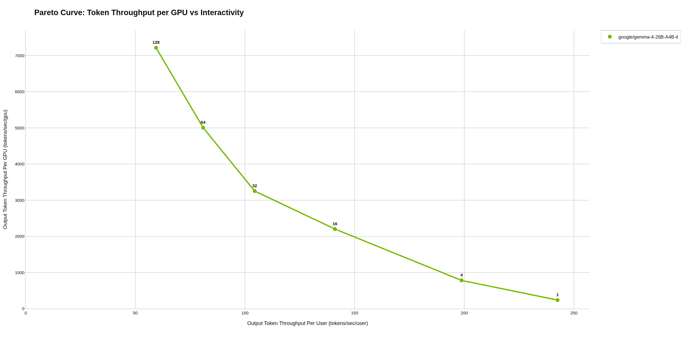

### google/gemma-4-E4B-it

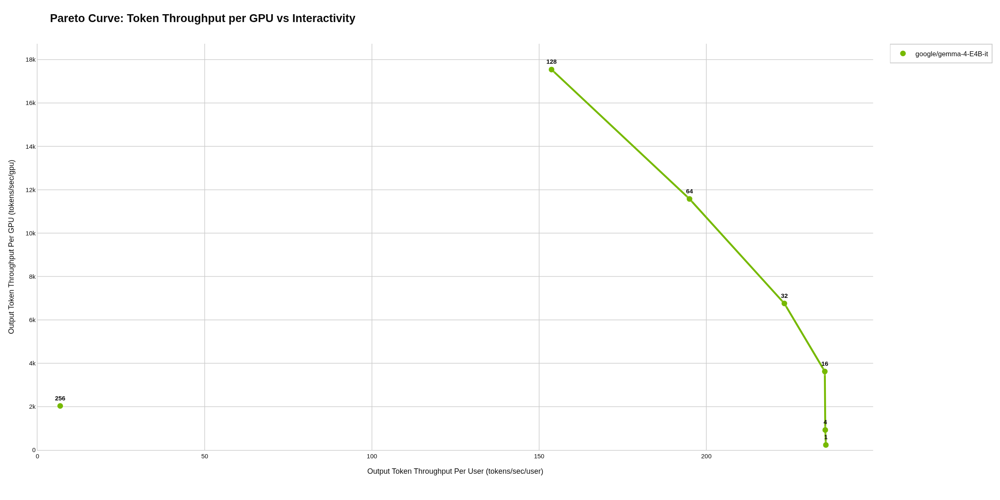

### google/gemma-4-E4B-it-qat-w4a16-ct

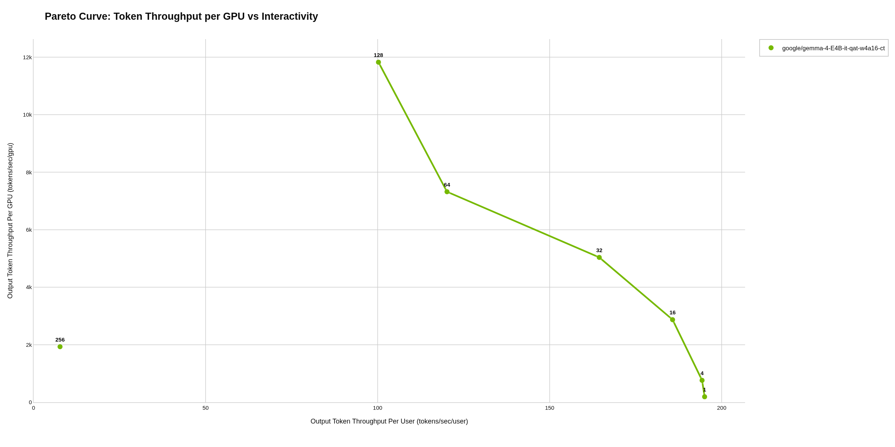

### ibm-granite/granite-4.2-30b

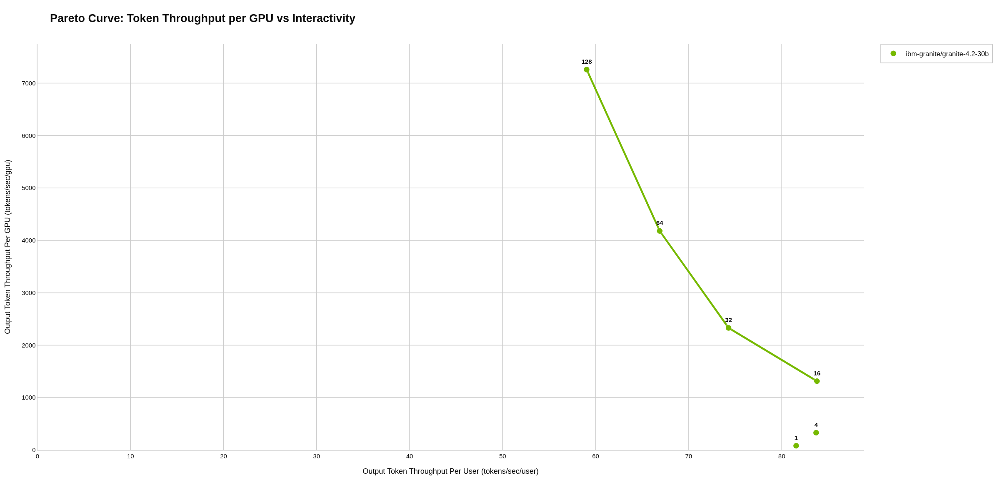

### Inferact/Qwen3.8-27B-NVFP4

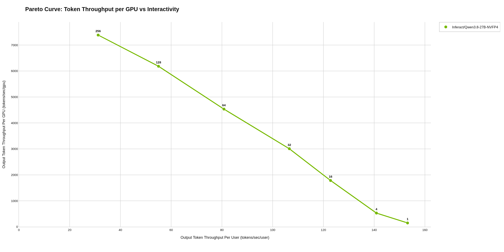

### nvidia/NVIDIA-Nemotron-3-Super-120B-A12B-NVFP4

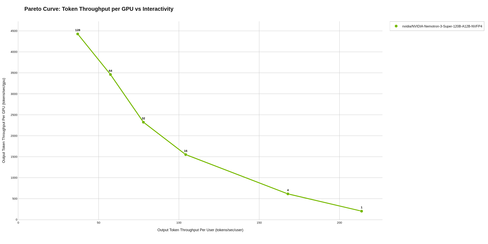

### nvidia/NVIDIA-Nemotron-3.5-Lightning-30B-A3B-NVFP4

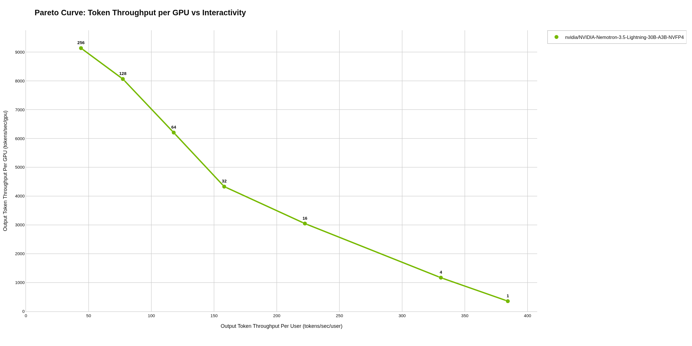

### nvidia/Qwen3.6-27B-NVFP4

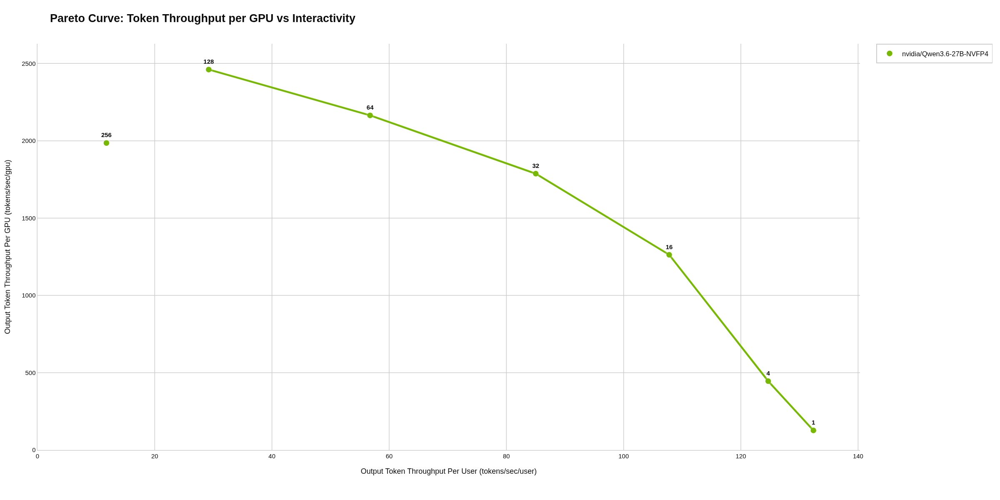

### nvidia/Qwen3.6-35B-A3B-NVFP4

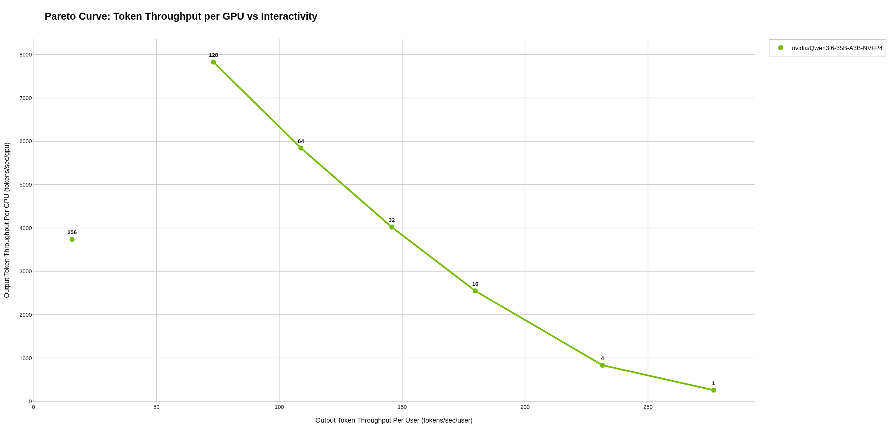

### Qwen/Qwen3.6-27B

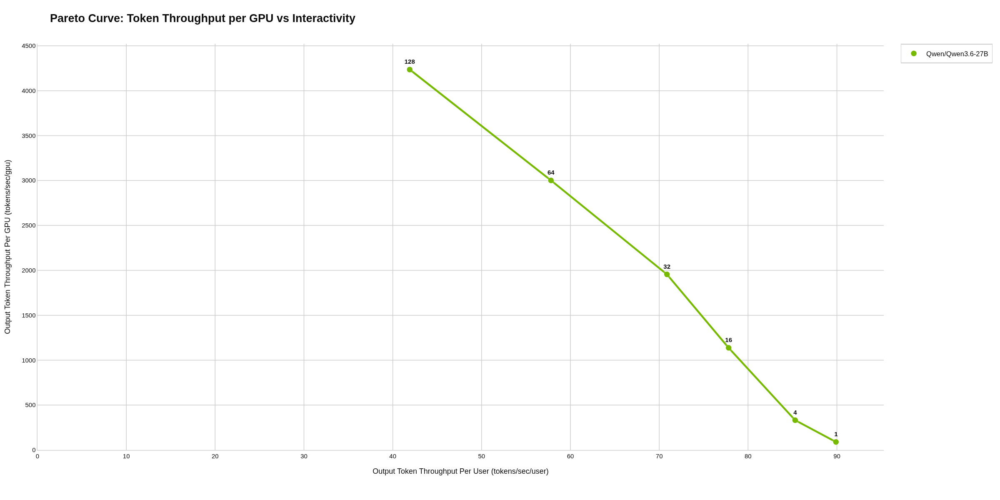

### Qwen/Qwen3.6-35B-A3B

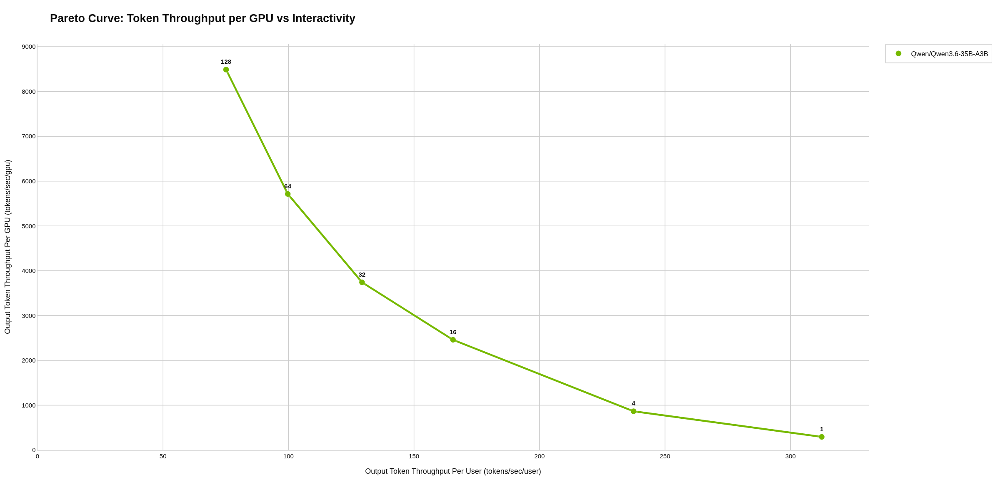

### Qwen/Qwen3.8-27B

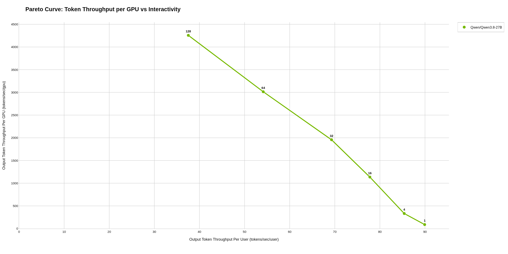

### Qwen/Qwen3.8-27B-FP8

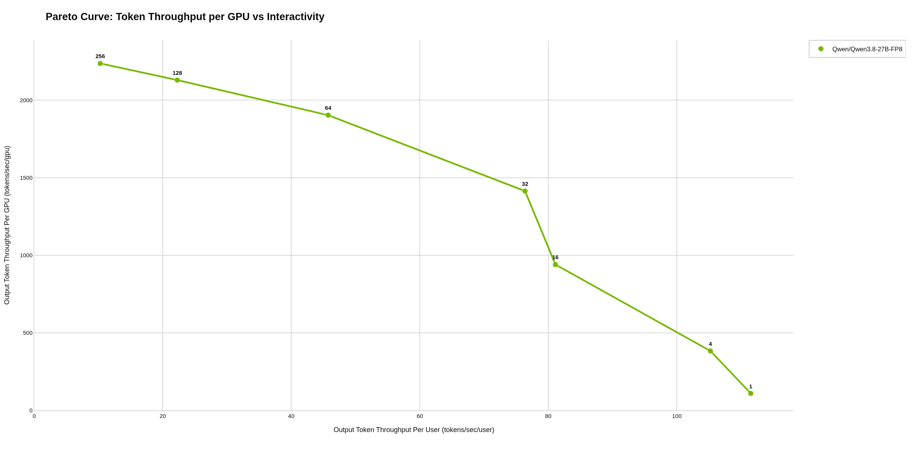

### RadixArk/Qwen3.8-Flash-Next-NVFP4

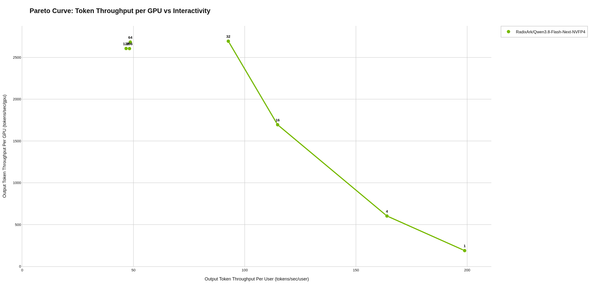

### unsloth/Qwen3.8-27B-NVFP4

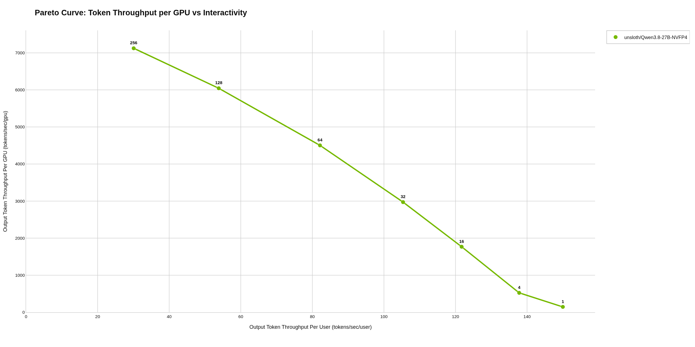

### MiniMaxAI/MiniMax-M2.7

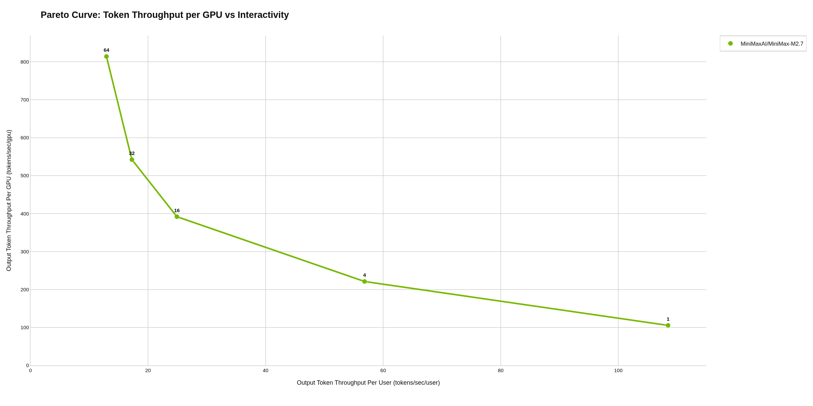

### nvidia/DeepSeek-V4-Flash-nvfp4-DSpark

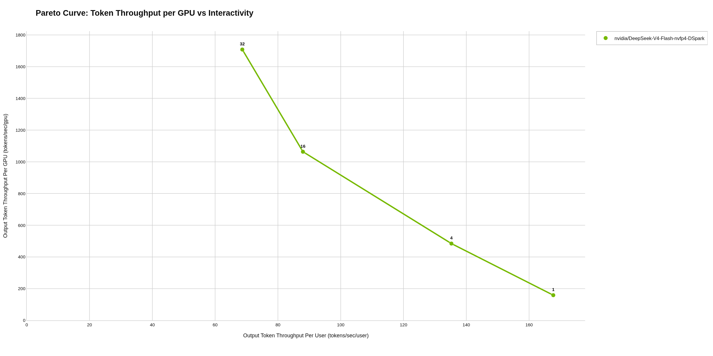

### RedHatAI/GLM-5.3-Flash-NVFP4

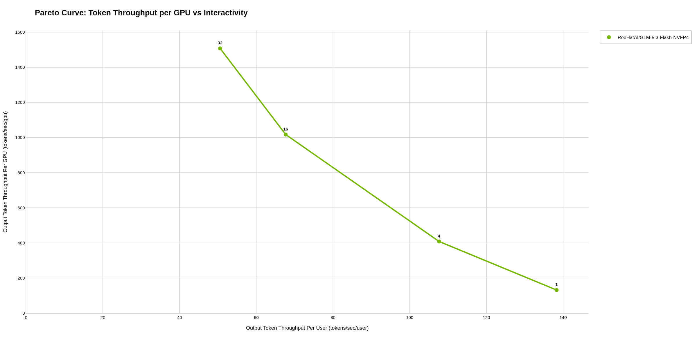

### zai-org/GLM-5.3-Flash

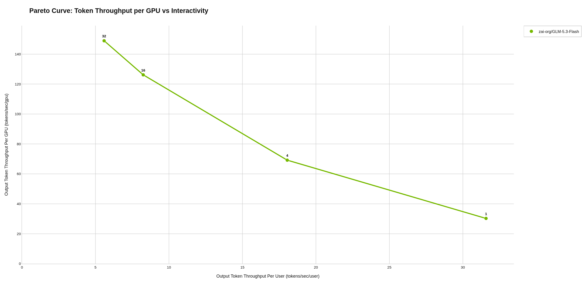

### nvidia/NVIDIA-Nemotron-3-Ultra-550B-A55B-NVFP4

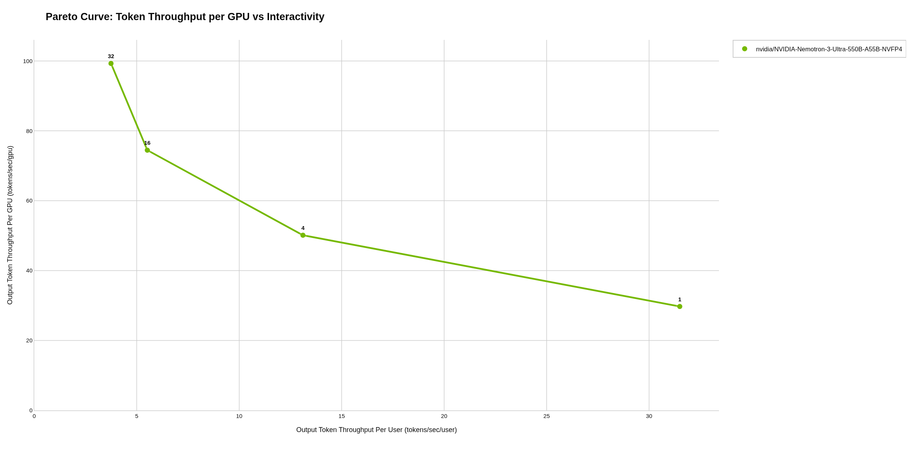
